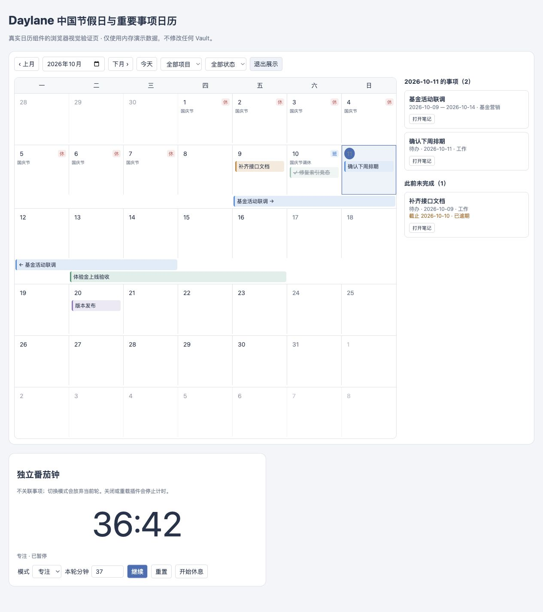

# Daylane 0.1.0 开发验证报告

验证日期：2026-10-11。显示名称为 Daylane: Chinese Holiday Calendar，ID 为 daylane，首版最低版本声明为 Obsidian 1.7.2，桌面专用。

## 已实现

- Markdown 事项存储与增量索引，支持单日待办、跨日固定日程、项目、颜色、状态、截止日期与原始计划日期。
- 大屏月历、侧栏紧凑日历、日历代码块、跨周条带、项目和状态筛选及展示模式。
- 中国大陆 2025、2026 年官方放假与调休上班安排，离线使用，未覆盖年份明确提示。
- 待办自动流转、全局和单条覆盖、自然日与工作日模式、最近批次持久化与安全撤回。
- 手动旧事项预览与复制导入，来源路径和内容指纹查重。
- 独立番茄钟，自定义专注和休息时长、暂停、继续、重置、单次到时提示与可选本地短音。

## 自动化与构建结果

| 检查 | 结果 |
| --- | --- |
| 中文声明注释检查 | 27 个源码、测试、预览与构建文件通过 |
| TypeScript 严格类型检查 | 通过 |
| 自动化测试 | 8 个测试文件、55 项测试通过 |
| 全项目行覆盖率 | 74.87% |
| 分支覆盖率 | 72.65% |
| 节假日模块 | 行与分支覆盖率均为 100% |
| 流转模块 | 行覆盖率 92.13% |
| 事项仓库 | 行覆盖率 90.56% |
| 独立计时模块 | 行覆盖率 100% |
| esbuild 插件构建 | 通过 |
| 发行包生成 | 通过，归档包含 main.js、manifest.json、styles.css 和 LICENSE |
| Git 空白差异检查 | 通过 |

测试通过模块边界模拟 Obsidian，未在业务源码添加测试专用状态或条件。测试覆盖索引冷启动、过期异步读取、删除与更名、重复 ID、原文保留、外部编辑冲突、流转日志失败、撤回冲突、导入查重、模式切换、表单提交以及共享面板计时。

覆盖率是自动化代码执行范围，不代表原生 Obsidian、真实设备或所有交互都已经通过。宿主设置页、提示音和部分命令仍需原生验收。

## 浏览器验证

使用真实 CalendarPanel、ItemRepository 与 TimerService，以及仅存在于预览目录的内存 Vault，完成以下操作：

- 检查 2026 年 10 月大屏布局、跨周事项条带、国庆放假与 10 月 10 日调休上班标记。
- 配置 37 分钟专注，确认计时启动、暂停和当前剩余时间。
- 切换展示模式，确认新建、编辑、完成、取消、改期和删除入口隐藏。

该图来自浏览器视觉验证，不是原生 Obsidian 截图。预览数据不写入用户 Vault。临时浏览器页与 HTTP 服务已在验证后关闭。

## 交付物与未执行事项

- 本地独立 Git 仓库与源码；没有创建提交或配置远程仓库。
- `dist/daylane/` 可安装目录与 `dist/daylane-0.1.0.zip` 归档。
- README、技术方案与原生人工验收清单。
- 本次没有修改或替换 Calendar Plus，也没有安装到用户日常 Vault。
- 尚未完成原生 Obsidian 安装、最低版本、弹出窗口、提示音或移动端实机验收。
- 尚未提交或发布到 Obsidian 官方插件市场。

## 明确边界

插件关闭期间不后台流转，也不继续番茄钟。开启应用后补处理未完成待办；番茄钟则从空闲状态开始。

流转恢复日志不是跨设备事务。若意外退出发生在写入笔记与保存文件摘要之间，该项不会被自动撤回，需按记录手动核对。撤回不会关闭单条或全局自动流转；若要长期保留恢复后的过期日期，需要关闭该项流转，否则后续检查可以再次顺延。

节假日数据只覆盖已收录年度。工作日模式不能推测尚未收录的正式放假安排。
