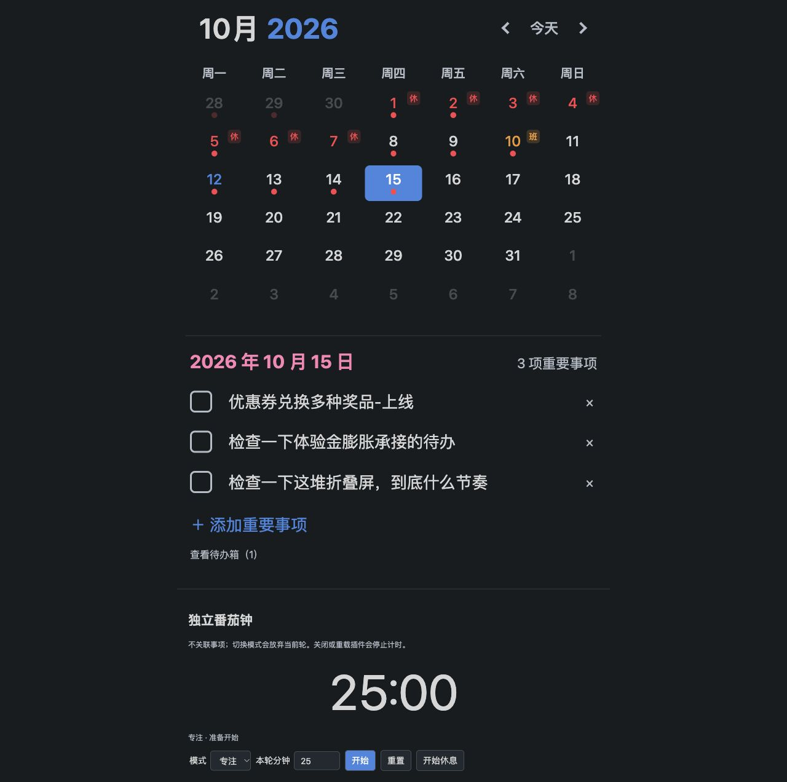

# Daymark 0.2.0 改造验证报告

日期：2026-10-12。作者 Cynthia Ding，桌面插件，最低 Obsidian 1.7.2。当前显示名称 Daymark: Chinese Holiday Calendar，插件 ID 保留 daylane。单日改造及更名在独立仓库完成；已部署到用户指定的新功能测试仓库，原有笔记保留。尚未发布社区市场。

## 结果

已按改造方案完成单日事项四属性模型、名称输入创建、可读重名编号与二级标题、默认侧栏、共享月历样式、五条命令、两卡片设置、右键改期、待办箱、累计自动流转上限和旧格式只读兼容／原文备份迁移。番茄钟保留独立自定义时长。节假日沿用已内置的 2025、2026 年离线数据。

## 自动化验证

- Vitest：8 个文件，56 项测试通过。
- 全项目行覆盖率 74.90%，分支覆盖率 68.96%；仓库行覆盖率 96.85%，流转行覆盖率 100%，迁移行覆盖率 91.78%，计时行覆盖率 100%。
- 测试覆盖识别范围、外部编辑、更名、过期异步读取、重名文件／目录、最多 16 并发读取及批量刷新、四属性写入、正文保留、计数不清零、5 次／第 6 次入箱、离线补偿、备份失败与预览冲突、根目录规范文件名、更名失败部分成功、只读面板、名称表单、右键菜单和默认侧栏／命令注册。
- 中文声明注释检查通过（28 个文件）；TypeScript 严格类型检查、esbuild 插件构建、发行包生成及 git diff --check 均通过。归档已核对包含 main.js、manifest.json、styles.css、LICENSE。

## 浏览器验证

通过真实 CalendarPanel 与 TimerPanel 的本地预览确认参考日期 2026-10-15 的月历、蓝色年与选中日期、红色事项圆点、节假日／调休角标、粉色日期标题和三个事项列表。已验证待办箱入口及返回月历。预览使用隔离的内存文件边界，不读写真实库。

## 限制

原生测试库已核验插件加载、五条命令注册、默认侧栏和两条自动流转结果；完整交互验收仍待完成，尚不能证明真实回收机制、链接更新、设置页或提示音全部通过。详见 manual-verification.md。工作日判断仅支持内置年份，缺失年份提示并拒绝猜测；本次部署只针对新功能测试仓库。

0.1.0 历史报告保留为 verification-report-0.1.0.md；旧版技术方案中的跨日／项目／颜色／撤回等功能已由 change-plan.md 中的新方案替代。
